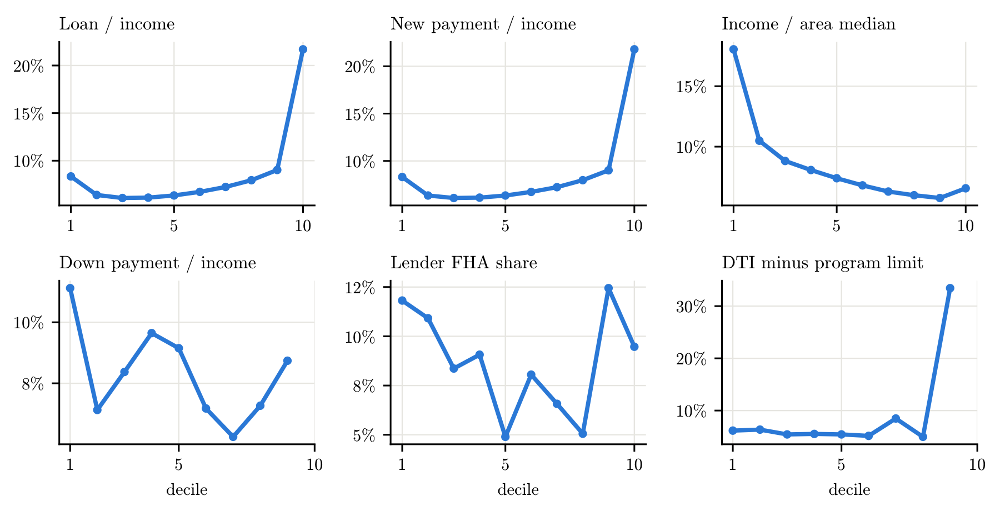
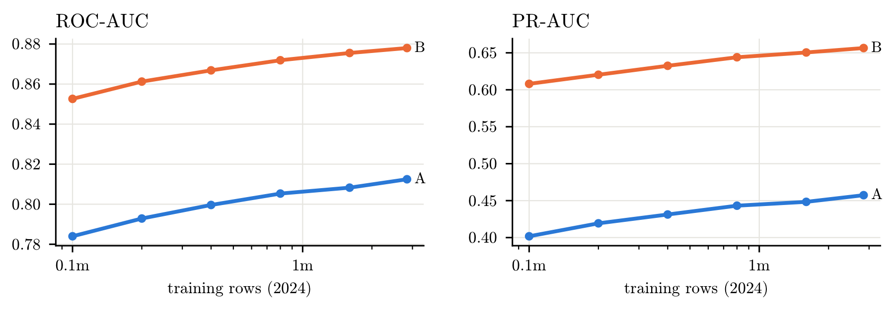

# Who Gets the Mortgage? Predicting Home-Purchase Loan Denials with HMDA Data

Will a US home-purchase mortgage application be **denied**? The data are the full public loan-level
records reported under the Home Mortgage Disclosure Act (HMDA): 3.14 million decided applications
in 2024 for training and 3.14 million in 2025, fixed as an untouched out-of-time hold-out.
8.8% of applications are denied.

The hard part is not the model but **leakage**. Many HMDA fields are produced during underwriting
or only *because of* the decision, and a naive model on all fields scores ROC-AUC 1.000. Most of
the work went into deciding what a lender actually knows at each point, and into an automated
leakage auditor that runs inside the training pipeline.

Originally built for the course *Big Data, Machine Learning, with Applications to Economics and
Finance* (ICEF, HSE University, autumn 2026).

## Results

Two models for two uses:
* **Model A, pre-application screening:** only what is known when the application is filed (loan
  terms, stated income, applicant, lender, location);
* **Model B, underwriting support:** A plus underwriting values (DTI, combined LTV, appraised
  property value, credit-score model), with the information in their *missingness* neutralised.

CatBoost trained on all 2.74 million training rows, scored on a fixed 2024 validation set of
300k rows (no-skill PR-AUC = denial rate = 0.089):

| | ROC-AUC | PR-AUC | Brier |
|---|---|---|---|
| Model A (application time) | 0.820 | 0.475 | 0.062 |
| **Model B (+ underwriting)** | **0.888** | **0.679** | **0.045** |

PR-AUC is the primary metric: approving everyone is already 91% accurate. Its business meaning is
*precision at a fixed recall*, i.e. how many flagged files really end up denied. Compared with the
underwriting cut-offs that the EDA suggests:

| Screen | Recall | Precision | Applications flagged |
|---|---|---|---|
| Rule: DTI ≥ 50% or LTV > 100% | 49% | 25% | 18% |
| Model A | 49% | 38% | 12% |
| **Model B** | **49%** | **84%** | **5%** |
| Rule: DTI > 43% or LTV > 97% | 70% | 13% | 48% |
| **Model B** | **70%** | **41%** | **15%** |

At the same recall model B is 3.3× as precise as the rule and flags 3.4× fewer files. It is also
well calibrated: mean predicted probability 0.088 against an observed rate of 0.089.

## Leakage: what does the lender know, and when?

Every column is placed in a timing tier:
* **A**: known when the application is filed;
* **U**: produced during underwriting (DTI, combined LTV and property value after the appraisal,
  the automated underwriting system (AUS) that was run, the credit-score model);
* **P**: recorded only after or because of the decision (rate, spread, costs, lender credits,
  HOEPA status, purchaser type, denial reasons, pre-approval and "initially payable" artefacts).
  Never used.

Within tier U a *missing* or "not applicable" value often records an early rejection, not a fact
about the applicant:
* among the 394 lenders that run an AUS on more than 98% of approved loans, AUS = "not applicable"
  appears on 0.7% of approved files and on 10.7% of denied ones, and comes with a 55% denial rate.
  The field is dropped;
* DTI and loan term are missing in 6–10% and 5.2% of credit-history denials, against 0.6% and 0.1%
  of approved files;
* of the 10,838 applications with LTV above 105%, 56% are denied, two thirds of them for
  collateral: an appraisal below the purchase price, known only during underwriting.

So model B uses no missing-value indicators: these fields are filled with training-fold values
inside the pipeline (`Neutraliser`). What each choice is worth (gradient boosting, 5-fold CV on
400k rows of 2024):

| Feature set | Features | ROC-AUC | PR-AUC |
|---|---|---|---|
| A: application time only | 23 | 0.789 | 0.401 |
| B: + underwriting values, missingness neutralised | 27 | 0.858 | 0.604 |
| C: + raw missing / N-A codes and AUS | 28 | 0.868 | 0.628 |
| D: + post-decision fields (naive) | 38 | **1.000** | **1.000** |
| E: D with the leakage auditor in the pipeline | 38 | 0.897 | 0.713 |
| E without "initially payable" | 37 | 0.869 | 0.630 |

The gain from C over B (+0.023 PR-AUC) comes from the lender's process, not from the applicant,
so it is excluded.

### The leakage auditor
[`leakage_audit.py`](leakage_audit.py) is a scikit-learn transformer, re-fitted on every training
fold. For each column it computes, on training data only:
* the out-of-fold AUC of the column alone (smoothed target encoding);
* whether a large level (≥ 1% of rows) has an almost certain outcome;
* how well the *missing* indicator predicts the outcome;
* a within-lender check: codes that are rare at a lender but come with a much higher denial rate
  than that lender's usual one. Some lenders fill in "not applicable" only for files they reject.

Strong signals give `drop` (the column is removed), weaker ones `review` (kept and reported for a
human decision). The auditor was validated on **positive controls**, fields known to leak. It
dropped eight of the nine automatically, flagged the ninth ("initially payable", within-lender
lift 22) for review, and dropped no legitimate feature.

### Imputation can leak too
Feature importance exposed a subtler leak. In an earlier version, "CLTV minus first-lien LTV" was
the second most important feature of model B. Missing LTV and property value had each been filled
with its own median, which produced impossible pairs, so the derived feature picked out the imputed
rows (AUC 0.69 for spotting them) and brought the missingness signal back. LTV and property value
are now imputed *consistently* with the loan amount and rounded like the public data. The AUC fell
to 0.53 ([`18_imputation_check.py`](18_imputation_check.py)), and every model-B result was re-run.

## Features

Engineered inside the pipeline by `FeatureBuilder` ([`fe.py`](fe.py)), from the row itself or
from training rows only:
* **affordability ratios:** loan / income, income and loan relative to the area median, payment on
  the new loan / income;
* **lender profile** (no target used): size, FHA share, broker share, median loan / income of its
  applicants;
* **program limits** (tier U): DTI minus the program's DTI guideline, LTV minus the program's
  maximum;
* **cash and second liens** (tier U): down payment / income, CLTV minus first-lien LTV.



A leave-one-group-out ablation kept the ratios and the lender profile, which carry the gain:
+0.028 PR-AUC for model A, +0.025 for model B. **External county data** from Data.gov (FHFA loan
limits and house prices, BLS unemployment, all lagged to what was public at the time) changed the
CV metrics by at most 0.001, below the fold-to-fold noise. It is kept out of the main
specification, and this negative result is reported.

## Models

| | Model A ROC / PR | Model B ROC / PR |
|---|---|---|
| *5-fold CV, same 400k rows of 2024* | | |
| Logistic regression (L2, splines, cross-fitted target encoding) | 0.779 / 0.366 | 0.827 / 0.517 |
| Gradient boosting, raw features | 0.789 / 0.401 | 0.858 / 0.604 |
| + engineered features | 0.798 / 0.429 | 0.867 / 0.629 |
| + tuned (successive halving) | 0.800 / 0.432 | 0.869 / 0.631 |
| CatBoost + engineered features | 0.805 / 0.444 | 0.874 / 0.646 |
| *Large training sets, fixed 300k validation rows* | | |
| Gradient boosting, tuned, all 2.84m rows | 0.813 / 0.459 | 0.879 / 0.657 |
| **CatBoost, all 2.74m training rows** | **0.820 / 0.475** | **0.888 / 0.679** |

* **Flexible learners clearly beat the logit**, most of all in model B (PR-AUC 0.517 vs 0.646):
  denials depend on combinations such as DTI relative to the loan program's limit.
* **Features add more than tuning:** +0.025–0.028 PR-AUC from feature engineering against
  +0.002–0.003 from tuning.
* **CatBoost is the strongest learner** by two to three fold standard deviations, most likely
  because of how it handles the lender and geography identifiers.
* **More data keeps helping:** the learning curve has not levelled off at 2.84 million rows, so the
  final models use all of them (about 2 h for model B and 1.2 h for model A on an 8-core Apple M3,
  early stopping at 3,175 and 2,528 trees).



## Limitations
* **This describes lender behaviour; it is not a credit model.** The feature set includes the
  applicant's age and the tract's minority share. Both help to explain observed decisions, but a
  model used to approve or price loans could not rely on them (ECOA / fair-lending rules; tract
  composition is a proxy for race).
* **The lender matters most.** The lender identifier (`lei`) is the top feature in both models:
  the same file is judged differently by different lenders, so part of the skill is learning each
  lender's policy. Results for lenders unseen in training will be weaker.
* **One year only so far.** All numbers come from validation rows inside 2024. The 2025 hold-out
  is fixed with a SHA-256 hash ([`results/holdout_spec.json`](results/holdout_spec.json)) and has
  not been scored yet.

## Next steps
Fixed before the hold-out is opened:
1. one-time evaluation of models A and B on 2025, with bootstrap confidence intervals;
2. with vs without external county data on 2025, and monotonic constraints on DTI, LTV and
   payment / income;
3. SHAP explanations compared with the denial reasons lenders report;
4. a fairness audit: the gap in denial rates by race and ethnicity that remains after conditioning
   on the model's prediction, with and without neighbourhood variables.

## Repository layout
```
*.py, *.ipynb            analysis scripts (run from the repository root, in the order below)
features.py              timing tiers, Neutraliser (consistent imputation), Prep
fe.py                    FeatureBuilder (ratios, lender profile, program limits, external data)
leakage_audit.py         LeakageAuditor (sklearn transformer)
models.py, cat_utils.py  data loading, pipelines, CatBoost input preparation
data/external/           public county data (FHFA loan limits & house prices, BLS unemployment)
results/                 JSON results and LaTeX tables; results/logs/ has the final training log
figs/                    figures (PDF; PNG copies in figs/png/)
reports/                 LaTeX write-ups: data & EDA, then leakage, features and models
run_all.sh               re-runs every model result in order (resumable)
run_on_mac.sh            sets up a venv, downloads the 2024 data, trains the final CatBoost models
```

## Reproducing
Python 3.10+:
```bash
python -m venv .venv && source .venv/bin/activate
python -m pip install -r requirements.txt
```
The raw HMDA files (~1.6 GB per year) are not in the repository. `HMDA_first_submission.ipynb`
downloads them from the FFIEC Data Browser API into `data/` and builds the samples
(alternatively place `data/hmda_2024.csv`, `data/hmda_2025.csv` and run `01_build_sample.py`).

| script | what it does | time* |
|---|---|---|
| `HMDA_first_submission.ipynb` | download, sample, EDA | ~15 min |
| `01_build_sample.py` | raw CSV → `data/sample_<year>.parquet` | 4 min |
| `01b_build_controls.py` | post-decision fields for the leakage auditor's positive controls | 4 min |
| `02_eda.py` | EDA tables and figures | 1 min |
| `03_feature_timing.py` | AUS / LTV / missingness diagnostics, leakage audit | 4 min |
| `04_cv_feature_sets.py`, `05_check_e_without_initially_payable.py` | feature sets A–E | 15 min |
| `07_external_data.py` | county data → `data/external_county.parquet` | <1 min |
| `06_feature_engineering.py [specs]` | feature engineering ablation | 2–3 min per spec |
| `08_holdout.py` | fixes 2025 as the hold-out | seconds |
| `09_logit.py` | logistic regression | 10 min |
| `10_learning_curve.py` | learning curve | 15 min |
| `11_tune_hgb.py`, `11b_eval_tuned.py cv/full` | gradient boosting tuning | 30 min |
| `12_catboost.py A/B` | CatBoost 5-fold CV | ~55 min per model |
| `14_tune_catboost.py` | CatBoost tuning | 30 min |
| `17_final_catboost.py B`, then `A` | final models on all training rows (needs ~16 GB RAM) | ~2 h / ~1.2 h on Apple M3 |
| `15_describe_all.py`, `18_imputation_check.py`, `19_audit_engineered.py` | appendix, checks | 10 min |
| `13_summary.py`, `16_report_tables.py` | all tables and numbers for the write-ups | seconds |

\* on a 2-core / 8 GB machine unless stated. For the final models:
`THREADS=8 RAMLIM=12gb ITERS=4000 python 17_final_catboost.py B` (or simply `bash run_on_mac.sh`).

## Data sources
* HMDA Loan/Application Register, 2024 and 2025 — [FFIEC HMDA Data Browser](https://ffiec.cfpb.gov/data-browser/)
* FHFA conforming loan limits and county house price index — [fhfa.gov](https://www.fhfa.gov/)
* BLS Local Area Unemployment Statistics, county annual averages — [bls.gov/lau](https://www.bls.gov/lau/)
